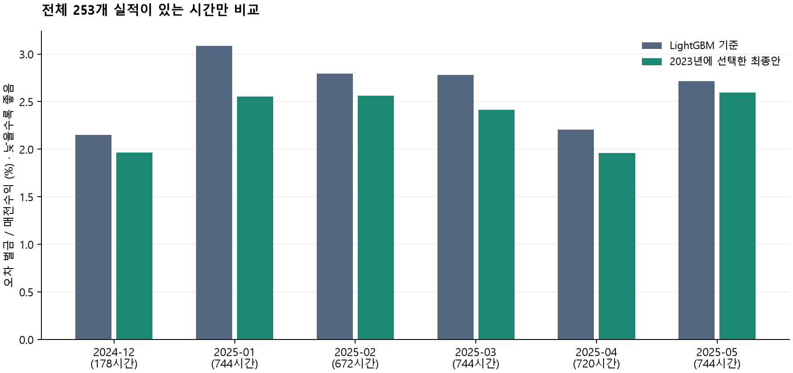

# OIBC_test1

2026 OIBC 태양광 발전 예측 첫 로컬 백테스트입니다.
**2022~2023년 학습 → 2024년 전체 및 2025년 1~5월 검증**을 수행했습니다.
공식 대회 제출은 하지 않았습니다.

## 결과

전체 253개 발전소의 실제 발전량이 모두 있는 **3,802시간** 기준입니다.

| 모델 | 오차 벌금(원) | 정산금 S(원) |
|---|---:|---:|
| 제공 LightGBM 기준 모델의 기간 변경 재학습 | 89,599,725 | 3,293,815,654 |
| GA-XGBoost + 참조 그룹 | 80,344,114 | 3,303,071,265 |

오차 벌금 **10.33% 감소**, 정산금 **0.281% 증가**입니다.
금액은 대회 정산식의 로컬 모의 계산이며 공식 서버 점수가 아닙니다.
2024년의 완전 관측은 178시간뿐이므로 연중 전체 성능이 확인된 것은 아닙니다.
2025년 개별 발전소 RMSE는 악화되어 모든 지표가 개선된 것도 아닙니다.

- [단계별 결과 보고서](results/BACKTEST_REPORT_KO.md)
- [전체 설계와 논문 적용 범위](BACKTEST_METHOD.md)
- [규정 확인 기록](OFFICIAL_RULES_CHECK_20261029.md)



## 구조

```text
제공 데이터 → 시간·결측 점검 → 예보·시간·설비 특징
                               ↓
                 LightGBM / GA-XGBoost 비교
                               ↓
                2023년 안에서 모델·그룹 선택
                               ↓
                  2022~2023년 최종 재학습
                               ↓
                2024~2025년 5월 발전소별 예측
                               ↓
                참조 그룹 합산 → 로컬 정산 채점
```

그룹 교환 탐색의 별도 검증 개선은 약 0.20%로, 사전 기준 1%에 못 미쳐 참조 그룹을 유지했습니다.
강건 입찰 논문은 대회 목적함수에 맞춰 검토했으며 별도의 SRO 입찰 보정은 적용하지 않았습니다.

## 저장소에 포함하지 않는 것

대회 원본 CSV/Parquet, 공식 배포 baseline.py, 학습 모델, 발전소별 예측, 그룹 배정 파일,
논문 PDF, 인증정보는 포함하지 않습니다. 결과 보고서와 그래프는 집계 요약만 담습니다.
제공 데이터를 보유한 참가자가 로컬에서 실행하는 코드입니다.

## 실행 준비

실행 당시 Python 3.14.7을 사용했습니다. 패키지 버전은 requirements-backtest.txt에 고정되어 있습니다.
제공 데이터 폴더는 다음 구조여야 합니다. 파일을 Git에 추가하지 마세요.

```text
01_participant_dataset/
  README.md
  baseline.py
  sites.csv
  train/
    generation.parquet
    forecast_wa.parquet
    forecast_wb.parquet
    smp.csv
```

이 코드는 배포 baseline.py의 solar/features 함수와 특징 목록을 불러옵니다.
따라서 원본 배포 파일이 로컬에 필요합니다. 학습 모델은 외부 사전학습 가중치 없이 학습합니다.

```powershell
py -m pip install -r requirements-backtest.txt
py -m unittest test_backtest test_validator -v

py -X utf8 backtest.py --data "C:\OIBC_data\01_participant_dataset" --out "C:\OIBC_local\backtest_new_run"
py -X utf8 verify_backtest_results.py --data "C:\OIBC_data\01_participant_dataset" --out "C:\OIBC_local\backtest_new_run"
py -X utf8 summarize_backtest.py --out "C:\OIBC_local\backtest_new_run"
```

출력은 OneDrive 밖의 새 로컬 폴더를 지정합니다. 완료된 실행 폴더는 덮어쓰지 않습니다.
다른 운영체제에서는 python 명령과 데이터·출력 경로를 환경에 맞게 바꾸세요.
최종 예측을 보고 모델 선택을 바꾸지 않으며, 첫 평가일 전날 17시 이후 실적은 학습에서 제외합니다.

## 확인한 항목

- 합성 데이터 안전·채점 테스트와 제출 형식 테스트 총 9개 통과.
- 공식 특징 생성과 10시/17시 각 96행 표본 일치.
- 별도 행렬 계산으로 정산금 재계산 일치.
- 원본 해시 보존, 예측 행 누락 없음, 각 그룹 20MW 이상 확인.

이는 로컬 검증이며 주최 측의 규정 인증이나 서버 승인을 뜻하지 않습니다.
backtest_forecast_NOT_FOR_SUBMISSION.csv는 검증기간용으로 공식 제출에 사용할 수 없습니다.
공식 제출 대상 기간은 2025년 6월~2026년 5월입니다.

## 파일 안내

| 파일 | 역할 |
|---|---|
| backtest.py | 특징 생성, 모델 선택, 그룹 탐색, 재학습, 예측, 채점 |
| test_backtest.py | 시간 경계, 정답 분리, 점수, 그룹 교환 합성 테스트 |
| verify_backtest_results.py | 결과 독립 재계산 및 원본·행·용량 검사 |
| summarize_backtest.py | 로컬 결과 보고서 및 그래프 생성 |
| validate_submission.py | 공식 제출 CSV 형식 검증 |
| test_validator.py | 형식 검증기의 합성 테스트 |

논문 방법은 대회 구조에 맞춰 일부 적용했으며 원 논문 전체 재현은 아닙니다.
